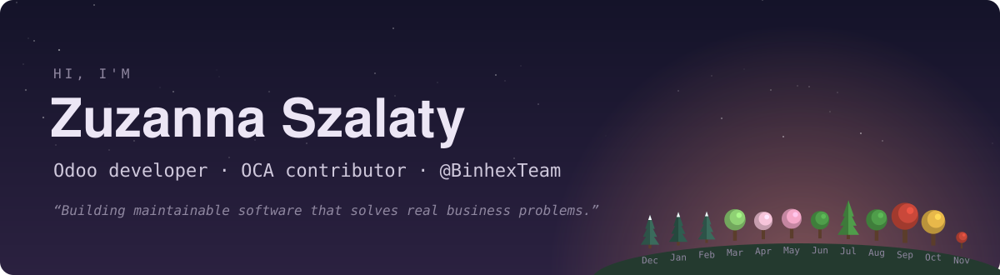
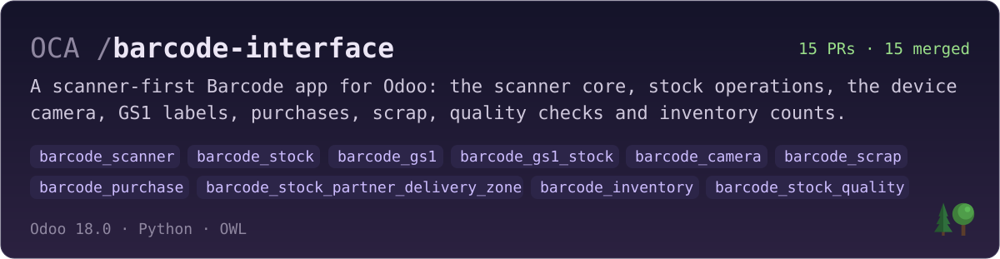
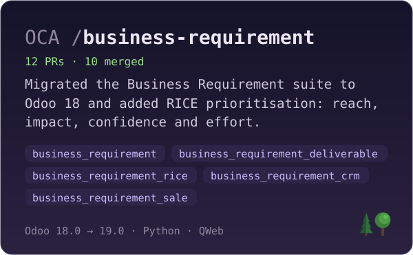
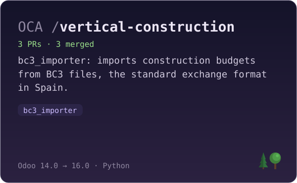

<!-- forest:start -->

<!-- forest:end -->

## What I'm building

Most of my open-source work goes to the [Odoo Community Association](https://github.com/OCA):

## About me

I've been building on Odoo since version 12 and now ship on 18 and 19 at [@BinhexTeam](https://github.com/BinhexTeam): custom modules, SaaS platforms, portals and integrations. I care about clean architecture, maintainable code and performance, and I'm curious about ERP architecture and AI-assisted development.

**Odoo** &nbsp;12 → 19 · OCA · ORM · OWL · QWeb · Controllers · Portal · Website & eCommerce · Reports · Security & access rights · Multi-company  
**Languages** &nbsp;Python · JavaScript · Java · C · C++  
**Tools** &nbsp;PostgreSQL · Docker · Linux · Git · GitHub · Jenkins · CI/CD · REST APIs

## Latest pull requests

<!-- pulls:start -->
- 🟣 [**barcode_stock**: keep the locations of the line picked](https://github.com/OCA/barcode-interface/pull/18) OCA/barcode-interface · 18.0 · FIX · Oct 26
- 🟣 [**barcode_stock**: open a move reserved against a lot with that lot chosen](https://github.com/OCA/barcode-interface/pull/17) OCA/barcode-interface · 18.0 · FIX · Oct 23
- 🟣 [**barcode_stock_quality**: run a reception's quality inspections from the Barcode app](https://github.com/OCA/barcode-interface/pull/16) OCA/barcode-interface · 18.0 · ADD · Oct 19
- 🟣 [**barcode_inventory**: count stock from the Barcode app](https://github.com/OCA/barcode-interface/pull/15) OCA/barcode-interface · 18.0 · ADD · Oct 16
- 🟣 [**barcode_stock**: open the first group the list shows](https://github.com/OCA/barcode-interface/pull/14) OCA/barcode-interface · 18.0 · FIX · Oct 15
- 🟣 [**barcode_stock_partner_delivery_zone**: group and filter operations by delivery zone](https://github.com/OCA/barcode-interface/pull/13) OCA/barcode-interface · 18.0 · ADD · Oct 15

🟣 merged · 🟢 open · ⚪ closed
<!-- pulls:end -->

[All my pull requests →](https://github.com/search?q=author%3Aszalatyzuzanna+is%3Apr&type=pullrequests)

The header, the forest, the cards and this list refresh every day with a GitHub Action (see <code>tools/profile</code>).
